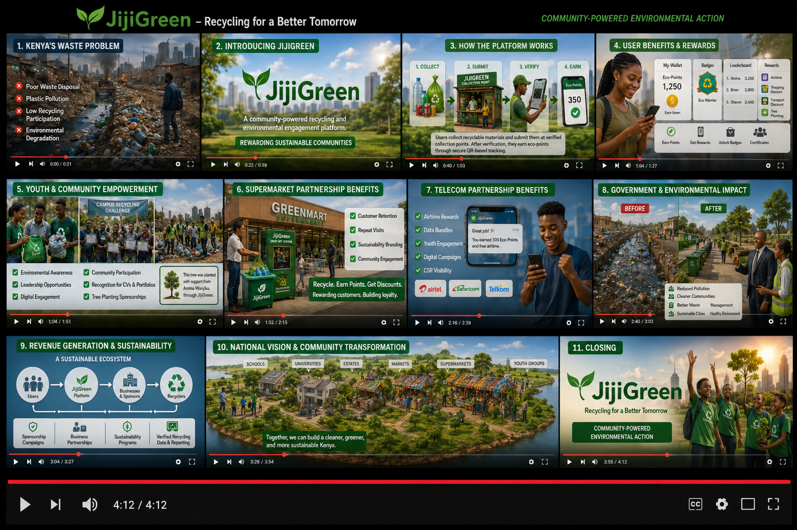

# JijiGreen 🌱

### Community-Powered Recycling & Environmental Engagement Platform

JijiGreen is a technology-driven environmental engagement and recycling platform designed to improve waste management, increase recycling participation, and reward sustainable behavior through community participation, gamification, and verified recycling systems.

The platform enables users to collect recyclable materials, submit them at verified collection points, earn eco-points, and redeem rewards while contributing to cleaner and greener communities.

---

# 🌍 Problem Statement

Kenya continues to face major environmental challenges including:

- Poor waste disposal
- Plastic pollution
- Blocked drainage systems
- Illegal dumping
- Low recycling participation
- Weak community engagement in sustainability
- High waste collection logistics costs

Many existing systems struggle because:
- Collection logistics are expensive
- Users lack motivation
- Verification systems are weak
- Recycling participation remains low

JijiGreen addresses these challenges using:
- Community-powered participation
- Decentralized collection points
- QR-based verification
- Reward systems
- Sustainability partnerships
- Gamification

---

# 💡 What is JijiGreen?

JijiGreen is a platform where users:

1. Register and receive a unique QR code
2. Collect recyclable materials
3. Submit waste at verified collection points
4. Earn eco-points after verification
5. Redeem rewards and gain environmental recognition

The platform combines:
- Recycling
- Digital rewards
- Community participation
- Environmental awareness
- Sustainability campaigns
- Gamification
- Verified recycling systems

---

# 🎯 Vision

To build a scalable environmental participation ecosystem that makes sustainability rewarding, trackable, and community-driven across Kenya.

---

# 🚀 MVP Goal

The first version (MVP) focuses on building a realistic and scalable recycling participation platform.

---

## MVP Features

- User registration & authentication
- QR code generation
- QR code scanning
- Eco-point wallet
- Waste submission tracking
- Verified collection points
- Reward redemption system
- Digital badges & certificates
- Leaderboards
- Admin dashboard
- Mobile-responsive web app

---

## Initial Waste Categories

The MVP will initially focus on:

- Plastic bottles
- Aluminum cans

This allows:
- Faster validation
- Simpler operations
- Easier partnership onboarding
- Cleaner recycling workflows

The goal is to validate:
- User engagement
- Reward participation
- Verification systems
- Collection workflows
- Partner collaboration

before scaling further.

---

# ⚙️ How JijiGreen Works

---

## 1. User Registration

Users create accounts and receive unique QR codes.

---

## 2. Waste Collection

Users collect recyclable materials such as:
- Plastic bottles
- Aluminum cans

---

## 3. Waste Submission

Users submit recyclables at nearby verified collection points such as:
- Kiosks
- Supermarkets
- Schools
- Universities
- Salons
- Community centers

---

## 4. Verification

Collection agents:
- Verify waste type
- Confirm quantity/weight
- Scan user QR codes
- Approve submissions

---

## 5. Eco-Point Allocation

Users receive eco-points based on:
- Waste type
- Quantity
- Verified submissions

---

## 6. Rewards & Recognition

Users can redeem:
- Airtime rewards
- Shopping discounts
- Digital badges
- Certificates
- Sustainability recognition
- Tree-planting sponsorships

---

# 🛡️ Verification & Anti-Fraud System

Verification is one of JijiGreen’s core innovations.

The system uses:
- QR-based identification
- Authorized collection-point approval
- Submission tracking
- Timestamp logging
- Quantity/weight verification
- Duplicate submission prevention

This helps ensure:
- Transparency
- Fair eco-point allocation
- Accountability
- Trust between stakeholders

---

# 🌳 Tree-Planting Integration

JijiGreen also integrates environmental restoration initiatives such as tree planting.

Users may:
- Sponsor tree planting using eco-points
- Participate in sustainability campaigns
- Receive digital recognition certificates

Example:
> “This tree was planted with support from [User Name] through JijiGreen.”

This increases:
- User recognition
- Emotional engagement
- Sustainability participation

---

# 🎮 Gamification & User Engagement

JijiGreen uses gamification to encourage long-term participation.

---

## Features

- Eco-points
- Digital badges
- Leaderboards
- Certificates
- Competitions
- Reward systems
- Community rankings

The goal is to make sustainability:
- Rewarding
- Social
- Engaging
- Community-driven

---

# 👥 Stakeholders & Benefits

---

# 👤 Users / Community Members

## Role
- Collect recyclable waste
- Participate in sustainability campaigns
- Submit recyclable materials

---

## Benefits

Users benefit through:
- Eco-points
- Airtime rewards
- Shopping discounts
- Digital badges
- Sustainability certificates
- Community recognition
- Participation in environmental programs

---

# 🧑‍🎓 Youth & Students

JijiGreen strongly focuses on youth participation.

---

## Benefits to Youth

- Environmental awareness
- Leadership opportunities
- Digital engagement
- Eco-competitions
- Recognition useful for CVs & portfolios
- Sustainability participation
- Community impact involvement

The platform transforms sustainability into an engaging and rewarding experience.

---

# 🏪 Supermarkets

## Role
- Host recycling collection points
- Participate in reward campaigns
- Support sustainability initiatives

---

## Benefits

JijiGreen helps supermarkets:
- Increase customer retention
- Increase repeat visits
- Improve sustainability branding
- Strengthen community engagement
- Build positive environmental reputation

---

## Example

Users recycle waste and redeem shopping vouchers, encouraging repeat supermarket visits and additional purchases.

---

# 📱 Telecom Companies

## Role
- Sponsor airtime and data rewards
- Support digital sustainability campaigns

---

## Benefits

Telecom companies benefit through:
- Increased youth engagement
- CSR visibility
- Sustainability branding
- Digital campaign exposure

---

## Example Rewards

- Airtime bundles
- Data packages
- Sponsored campaigns

---

# 🏫 Schools & Universities

## Role
- Environmental awareness hubs
- Sustainability campaign centers
- Collection points

---

## Benefits

- Student engagement
- Eco-club participation
- Sustainability competitions
- Community impact initiatives

---

# ♻️ Recycling Companies

## Role
- Process recyclable materials
- Partner with JijiGreen collection systems

---

## Benefits

- Cleaner recyclable materials
- Structured collection systems
- Increased recycling efficiency
- Better recycling consistency

---

# 🏛️ Government & Environmental Organizations

## Benefits

JijiGreen supports:
- Reduced urban pollution
- Improved recycling participation
- Cleaner public spaces
- Reduced pressure on dumpsites
- Environmental awareness campaigns
- National sustainability goals

---

# 💰 Revenue Model

JijiGreen uses a hybrid sustainability model.

---

## Revenue Sources

### 1. Sponsorship Campaigns

Brands sponsor:
- Eco challenges
- Reward campaigns
- Sustainability programs

---

### 2. Business Partnerships

Businesses partner with JijiGreen for:
- Sustainability campaigns
- Community engagement
- Environmental visibility

---

### 3. Verified Participation Data

Future opportunities may include:
- Recycling participation reporting
- Sustainability analytics
- Environmental engagement insights

---

### 4. Grants & Climate Innovation Funding

Potential support sources:
- Climate innovation programs
- Environmental organizations
- Sustainability grants
- Green-tech initiatives

---

# 🌍 Environmental Impact

JijiGreen contributes to:
- Reduced plastic pollution
- Cleaner drainage systems
- Improved recycling participation
- Better waste separation
- Increased environmental awareness
- Community sustainability culture

---

# 📈 SDG Alignment

JijiGreen aligns with:

- SDG 11 — Sustainable Cities and Communities
- SDG 12 — Responsible Consumption and Production
- SDG 13 — Climate Action
- SDG 8 — Decent Work and Economic Growth

---

# 🛠️ Proposed MVP Tech Stack

After evaluating modern startup technologies for:
- scalability,
- MVP development speed,
- ecosystem maturity,
- maintainability,
- and team collaboration,

the team agreed on the MERN stack architecture.

---

## Frontend

- React
- Vite
- TypeScript
- Tailwind CSS

---

## Backend

- Node.js
- Express.js

---

## Database

- MongoDB Atlas

---

## Authentication

- JWT Authentication
- bcrypt password hashing

---

## QR Functionality

- qrcode
- html5-qrcode

---

## Hosting

### Frontend
- Vercel

### Backend
- Render / Railway

---

## Version Control

- GitHub

---

# 📌 Why MERN Stack?

The MERN stack was selected because it provides:

- Fast MVP development
- Large developer ecosystem
- Strong community support
- Real-time capability
- Easy frontend/backend integration
- Excellent React ecosystem
- Faster onboarding for contributors

The architecture prioritizes:
- Speed
- Simplicity
- Scalability
- Team productivity

while avoiding unnecessary overengineering during the MVP stage.

---

# 🧠 Long-Term Expansion Ideas

Potential future features include:
- AI waste identification
- Smart sustainability analytics
- Mobile application
- Partner dashboards
- Expanded waste categories
- Sustainability reporting tools
- Smart collection insights

These are future-stage features and NOT part of the initial MVP.

---

# 🤝 Contribution & Collaboration

JijiGreen is currently in:
> MVP / Prototype Development Stage

We welcome:
- Developers
- Designers
- Sustainability innovators
- Environmental partners
- Community contributors

---

# 🔒 Intellectual Property Notice

© 2026 JijiGreen Team. All Rights Reserved.

This repository and its contents are proprietary intellectual property of the JijiGreen Team.

Unauthorized copying, modification, distribution, commercialization, reproduction, or reuse of this project, in whole or in part, is strictly prohibited without written permission from the project owners.

The JijiGreen name, branding, documentation, platform architecture, workflows, designs, concepts, and associated materials are protected under applicable intellectual property and copyright laws.

Contributors acknowledge that all approved contributions made to this repository become part of the JijiGreen project unless otherwise agreed in writing.

---

# 📬 Project Status

Current Stage:
> MVP / Prototype Development

Target:
> Build a working community recycling participation platform for pilot testing in Kenya.

---

# 🌱 JijiGreen

### “Community-Powered Environmental Action”
